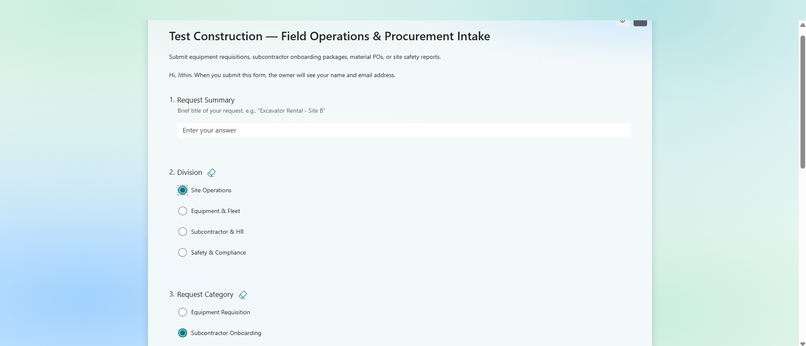
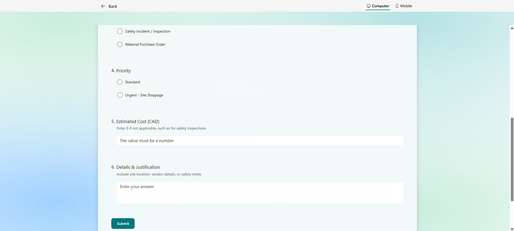
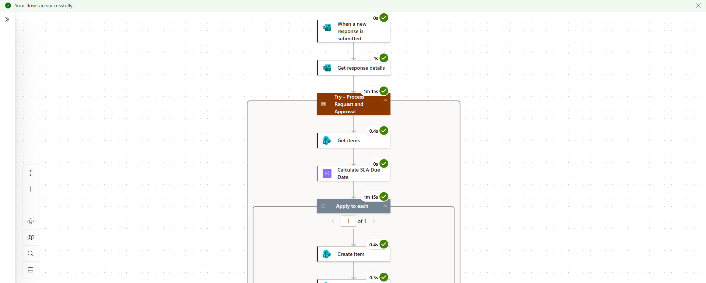
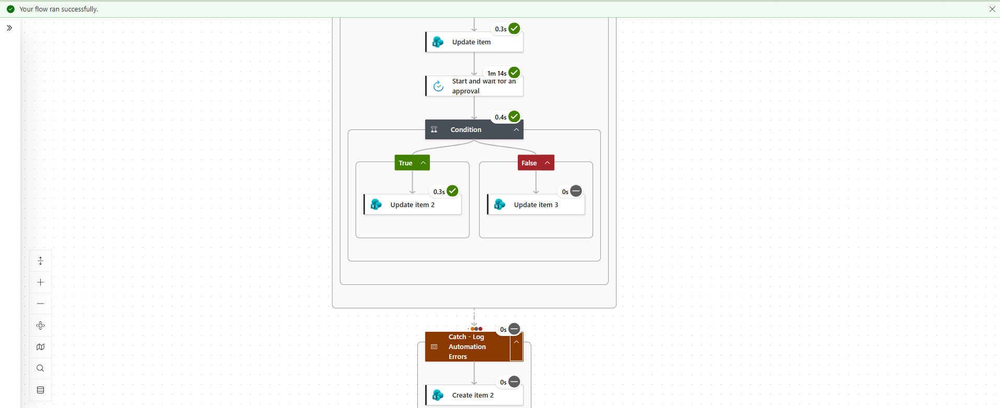
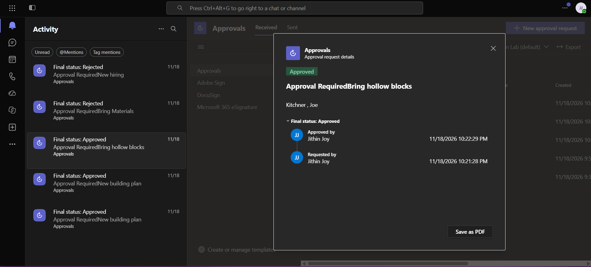
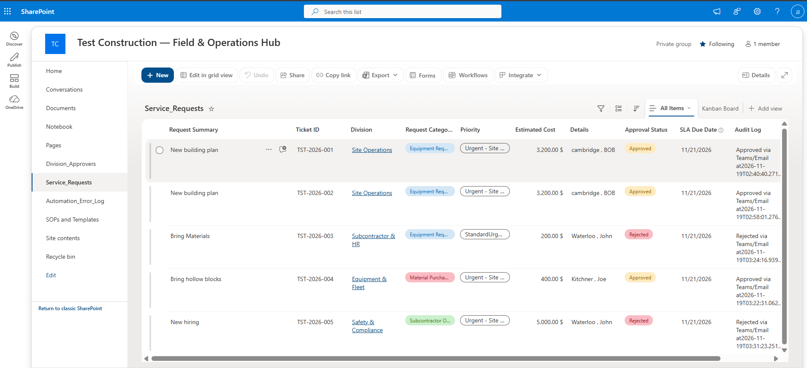
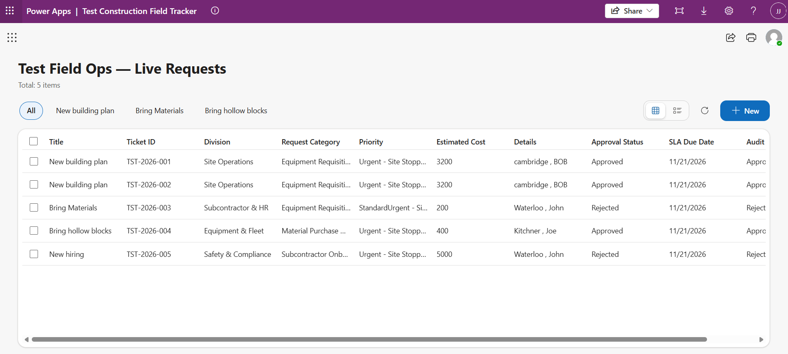

# Field Operations & Procurement Request Automation (Microsoft 365 and Power Platform)

A request intake and approval system built with Microsoft 365 and the Power Platform. It replaces email and spreadsheet requests for field operations, equipment requisitions, subcontractor onboarding, and safety compliance requests. Each request gets a ticket ID, an SLA due date, an approval step, and an audit record, and staff can follow progress in a Power Apps tracker.

## What it uses

| Part | Tool | What it does |
| :--- | :--- | :--- |
| **Intake** | Microsoft Forms | Mobile-friendly request form that captures division, category, priority, and cost estimate. |
| **Logic** | Power Automate | Creates ticket IDs (`TST-2026-XXX`), sets SLA due dates, sends approvals, writes audit entries, and logs errors with `Try / Catch` scopes. |
| **Data** | SharePoint Online | Lists for `Service_Requests`, `Division_Approvers`, `Automation_Error_Log`, and `SOPs and Templates`. |
| **Approvals** | Microsoft Teams and Outlook | Approval cards sent to each division's approver, with a timestamp on every decision. |
| **Tracker** | Power Apps (canvas app) | Live view where staff filter requests, check SLA deadlines, and see approval status. |

## How it works

### 1. Intake (Microsoft Forms)
Field staff submit requests through a form with required fields. Requests fall into four divisions: **Site Operations**, **Equipment & Fleet**, **Subcontractor & HR**, and **Safety & Compliance**.

  
   
  

### 2. Routing, SLA dates and error handling (Power Automate)
When a form is submitted, the flow does the following:
- **Ticket ID:** Reads the existing SharePoint items and creates the next zero-padded ID, such as `TST-2026-001`.
- **SLA due date:** Sets the target completion date from the request priority.
- **Approval:** Sends an approval request, then updates the status and adds a timestamped audit entry depending on whether it was approved or rejected.
- **Error handling:** The main actions sit inside a `Try` scope. If one fails or times out, a `Catch` scope (configured to run after failed or timed out) writes the details to the `Automation_Error_Log` list.

  
   
  

### 3. Approvals (Microsoft Teams)
Division approvers get a notification in Teams Approvals and by email. They can approve or reject in one click, and they see the requester and timestamp.

  

### 4. Records (SharePoint lists)
Submissions, SLA dates, status colours, and the approval history are stored in the `Service_Requests` list. It works with the lookup and logging lists `Division_Approvers`, `Automation_Error_Log`, and `SOPs and Templates`.

  

### 5. Tracker (Power Apps)
The canvas app (`Test Construction Field Tracker`) reads from the SharePoint list. Coordinators and managers can filter active requests and see costs, SLA deadlines, and approval results.

  

## Design notes
- **Audit trail:** Each status change writes a line in the form `Approved/Rejected via Teams/Email at [timestamp]`, so the history comes from the flow rather than manual edits.
- **Error logging:** Failed or timed-out actions are written to a SharePoint list instead of failing silently.
- **Separation of parts:** The form, the flow, the data, and the tracker are separate pieces, which makes each one easier to change and to control access to.
